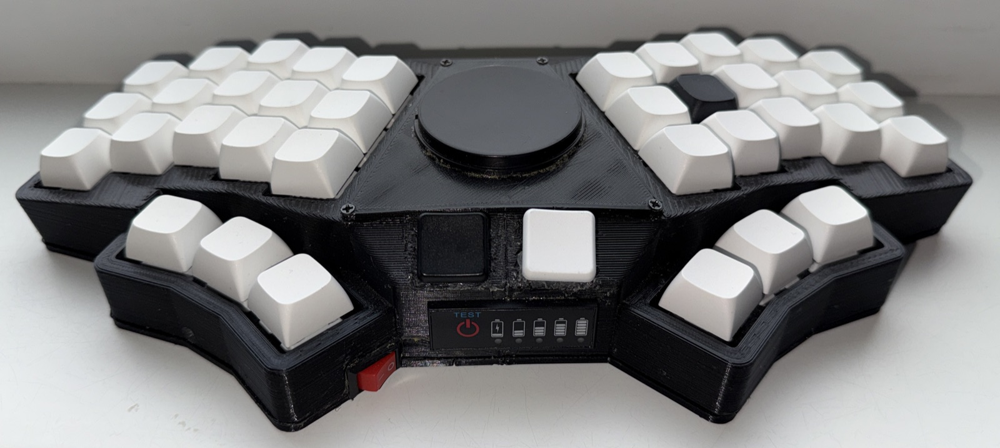

# KB38 — ZMK Firmware

A wireless 38-key monolithic split keyboard with a [Cirque](https://www.cirque.com/) trackpad, powered by a [nice!nano v2](https://nicekeyboards.com/nice-nano/) controller running [ZMK firmware](https://zmk.dev/).
SuperMini NRF52840 is pin-compatible and works as a drop-in replacement.



## Hardware

| Component | Specification |
|-----------|---------------|
| Controller | nice!nano v2 — `nice_nano//zmk` (nRF52840, Bluetooth 5.0) |
| Matrix | 4 rows x 10 cols, diodes col-to-row |
| Keys | 38 (5 columns x 3 rows + 4 thumb keys per side) |
| Trackpad | Cirque TM040040 — I2C, address 0x2A |
| Battery | 3.7 V 1S Li-Po (KMD 402030, 200 mAh) |
| Power switch | SPST rocker in series with battery + |
| Battery indicator | 1S Li-Po LED bar with TEST button |
| BLE name | KB38-Cirque |

See [wiring.md](wiring.md) for the full pin assignment and wiring diagram.

## Firmware

ZMK firmware with Bluetooth connectivity and trackpad support. The firmware is built automatically via GitHub Actions on every push.

### Keymap

7 layers with home row mods, trackpad scroll, and a media layer, plus a macOS / Windows-Linux toggle (see [OS Mode](#os-mode)).
The layout is shared with [sweep-split-keyboard](https://github.com/nsinotov/sweep-split-keyboard); KB38 adds mouse buttons and Caps keys on the outer thumbs.

```
BASE (QWERTY + home row mods)
┌─────┬─────┬─────┬─────┬─────┐       ┌─────┬─────┬─────┬─────┬─────┐
│  Q  │  W  │  E  │  R  │  T  │       │  Y  │  U  │  I  │  O  │  P  │
├─────┼─────┼─────┼─────┼─────┤       ├─────┼─────┼─────┼─────┼─────┤
│ ⌥/A │ ⇧/S │ ⌃/D │ ⌘/F │HYP/G│       │HYP/H│ ⌘/J │ ⌃/K │ ⇧/L │ ⌥/; │
├─────┼─────┼─────┼─────┼─────┤       ├─────┼─────┼─────┼─────┼─────┤
│  Z  │  X  │  C  │  V  │  B  │       │  N  │  M  │  ,  │  .  │  /  │
└─────┼─────┼─────┼─────┼─────┘       └─────┼─────┼─────┼─────┼─────┘
      │LCLK │ CW  │S/TAB│N/SPC│       │M/RET│#/BSP│ CW  │RCLK │
      └─────┴─────┴─────┴─────┘       └─────┴─────┴─────┴─────┘
  S=SYM  N=NAV  M=MEDIA  #=NUM   (hold = layer, tap = key)
  LCLK/RCLK = mouse buttons   CW = Caps Word

SYM (symbols)
┌─────┬─────┬─────┬─────┬─────┐       ┌─────┬─────┬─────┬─────┬─────┐
│  !  │  @  │  #  │  $  │  %  │       │  ^  │  &  │  *  │  (  │  )  │
├─────┼─────┼─────┼─────┼─────┤       ├─────┼─────┼─────┼─────┼─────┤
│ ⌥/< │ ⇧/> │ ⌃/` │ ⌘/' │  \  │       │  -  │ ⌘/= │ ⌃/; │ ⇧/[ │ ⌥/] │
├─────┼─────┼─────┼─────┼─────┤       ├─────┼─────┼─────┼─────┼─────┤
│  ?  │  /  │  ~  │  "  │  |  │       │  _  │  +  │  :  │  {  │  }  │
└─────┼─────┼─────┼─────┼─────┘       └─────┼─────┼─────┼─────┼─────┘
      │LCLK │     │     │     │       │ RET │ DEL │     │RCLK │
      └─────┴─────┴─────┴─────┘       └─────┴─────┴─────┴─────┘

NAV (navigation)
┌─────┬─────┬─────┬─────┬─────┐       ┌─────┬─────┬─────┬─────┬─────┐
│     │     │CAPS │CAPWD│     │       │HOME │PG_DN│PG_UP│ END │     │
├─────┼─────┼─────┼─────┼─────┤       ├─────┼─────┼─────┼─────┼─────┤
│  ⌥  │  ⇧  │  ⌃  │  ⌘  │SCRL │       │  ←  │  ↓  │  ↑  │  →  │     │
├─────┼─────┼─────┼─────┼─────┤       ├─────┼─────┼─────┼─────┼─────┤
│     │     │COPY │PASTE│     │       │     │     │     │     │     │
└─────┼─────┼─────┼─────┼─────┘       └─────┼─────┼─────┼─────┼─────┘
      │LCLK │     │     │     │       │ RET │ DEL │     │RCLK │
      └─────┴─────┴─────┴─────┘       └─────┴─────┴─────┴─────┘

NUM (numbers + function keys)
┌─────┬─────┬─────┬─────┬─────┐       ┌─────┬─────┬─────┬─────┬─────┐
│ F1  │ F2  │ F3  │ F4  │ F5  │       │ F6  │ F7  │ F8  │ F9  │ F10 │
├─────┼─────┼─────┼─────┼─────┤       ├─────┼─────┼─────┼─────┼─────┤
│ ⌥/1 │ ⇧/2 │ ⌃/3 │ ⌘/4 │  5  │       │  6  │ ⌘/7 │ ⌃/8 │ ⇧/9 │ ⌥/0 │
├─────┼─────┼─────┼─────┼─────┤       ├─────┼─────┼─────┼─────┼─────┤
│ F11 │     │     │     │     │       │     │     │     │     │ F12 │
└─────┼─────┼─────┼─────┼─────┘       └─────┼─────┼─────┼─────┼─────┘
      │LCLK │     │ TAB │ SPC │       │     │     │     │RCLK │
      └─────┴─────┴─────┴─────┘       └─────┴─────┴─────┴─────┘

MEDIA (hold ENTER)
┌─────┬─────┬─────┬─────┬─────┐       ┌─────┬─────┬─────┬─────┬─────┐
│ BT0 │ WIN │PREV │NEXT │PLAY │       │ BT3 │     │     │USTCK│RESET│
├─────┼─────┼─────┼─────┼─────┤       ├─────┼─────┼─────┼─────┼─────┤
│ BT1 │     │VOL- │VOL+ │MUTE │       │ BT4 │     │     │     │BOOT │
├─────┼─────┼─────┼─────┼─────┤       ├─────┼─────┼─────┼─────┼─────┤
│ BT2 │     │BRI- │BRI+ │     │       │ BT5 │     │     │     │BTCLR│
└─────┼─────┼─────┼─────┼─────┘       └─────┼─────┼─────┼─────┼─────┘
      │LCLK │     │     │     │       │     │     │     │RCLK │
      └─────┴─────┴─────┴─────┘       └─────┴─────┴─────┴─────┘

SCROLL (hold SCRL on NAV layer — slide on the trackpad to scroll)
┌─────┬─────┬─────┬─────┬─────┐       ┌─────┬─────┬─────┬─────┬─────┐
│     │     │CAPS │CAPWD│     │       │HOME │PG_DN│PG_UP│ END │     │
├─────┼─────┼─────┼─────┼─────┤       ├─────┼─────┼─────┼─────┼─────┤
│  ⌥  │  ⇧  │  ⌃  │  ⌘  │(hld)│       │  ←  │  ↓  │  ↑  │  →  │     │
├─────┼─────┼─────┼─────┼─────┤       ├─────┼─────┼─────┼─────┼─────┤
│     │     │COPY │PASTE│     │       │     │     │     │     │     │
└─────┼─────┼─────┼─────┼─────┘       └─────┼─────┼─────┼─────┼─────┘
      │LCLK │     │     │     │       │ RET │ DEL │     │RCLK │
      └─────┴─────┴─────┴─────┘       └─────┴─────┴─────┴─────┘
  All keys fall through to NAV. Trackpad Y = vertical scroll, X = horizontal scroll.
```

Layer 2 is intentionally empty (see [Known Issues](#known-issues)).

### OS Mode

COPY and PASTE on the NAV layer default to macOS shortcuts (Cmd+C / Cmd+V).
Press **WIN** on the MEDIA layer to switch them to Windows/Linux shortcuts (Ctrl+C / Ctrl+V); press it again to switch back.
The mode is not saved and resets to macOS after a reboot or deep sleep.

### Combos

| Keys | Action | Active Layers |
|------|--------|---------------|
| S + D | Escape | BASE |
| K + L | Escape | BASE |

### Features

- **Home row mods** with bilateral hold-trigger (left mods trigger on right-hand keys and vice versa)
- **Hyper key** (Ctrl+Shift+Alt+GUI) on G and H
- **Cirque trackpad** with mouse buttons on the outer thumb keys and a scroll layer
- **Caps Word** on the right outer thumb key and on NAV
- **Key repeat** — tap a thumb key, then press and hold it within 200 ms to auto-repeat its tap key (e.g. Backspace)
- **OS toggle** for copy/paste shortcuts (macOS ↔ Windows/Linux)
- **Deep sleep** after 15 minutes of inactivity
- **Bluetooth** with +8 dBm TX power for extended range

## Building Firmware

### GitHub Actions (recommended)

Push to the repository and GitHub Actions will build the firmware automatically. Download the `.uf2` files from the Actions artifacts.

### Local Build (Docker)

```bash
./build.sh            # build kb38 firmware
./build.sh reset      # build settings_reset firmware
./build.sh --flash    # build and copy to the bootloader drive
```

### Flashing

1. Connect the nice!nano via USB
2. Double-press the reset button to enter bootloader mode (the `NICENANO` drive mounts)
3. Copy `kb38.uf2` to the mounted drive, or run `./build.sh --flash`
4. The controller will flash and reboot automatically

To clear Bluetooth bonds, flash `settings_reset.uf2` first.

## SuperMini NRF52840

Pin-compatible drop-in replacement for nice!nano v2. Uses the same `nice_nano//zmk` board target. Known differences:

- LED colors are swapped (blue = BT, red = charging)
- Battery voltage divider (P0.24) is unpopulated by default
- Sleep current is higher (~700 µA vs ~20 µA on genuine nice!nano)

## Known Issues

- **Layer 2 is intentionally empty.** ZMK firmware bug: layer index 2 + key position 2 causes BLE disconnect. Do not assign bindings to layer 2.
- **Trackpad sensitivity above 2x causes an erratic cursor.** With `"3x"` or `"4x"`, the cursor flies to one corner instead of tracking finger movement. Keep it at `"2x"`.

## References

- [ZMK Firmware](https://zmk.dev/) — open-source keyboard firmware
- [nice!nano](https://nicekeyboards.com/nice-nano/) — nRF52840 Pro Micro-compatible controller
- [ZMK Cirque Pinnacle driver](https://zmk.dev/docs/features/pointing) — pointing device support
- [sweep-split-keyboard](https://github.com/nsinotov/sweep-split-keyboard) — sibling keyboard with the same layout

## License

[MIT](LICENSE)
